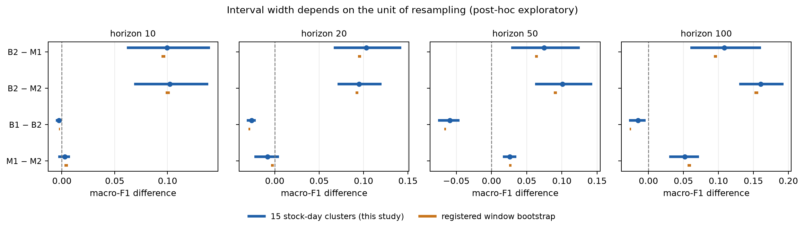
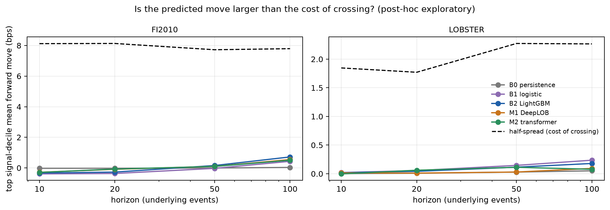
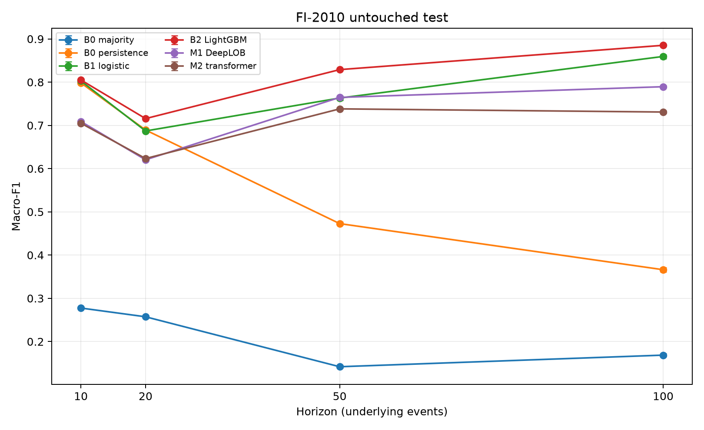
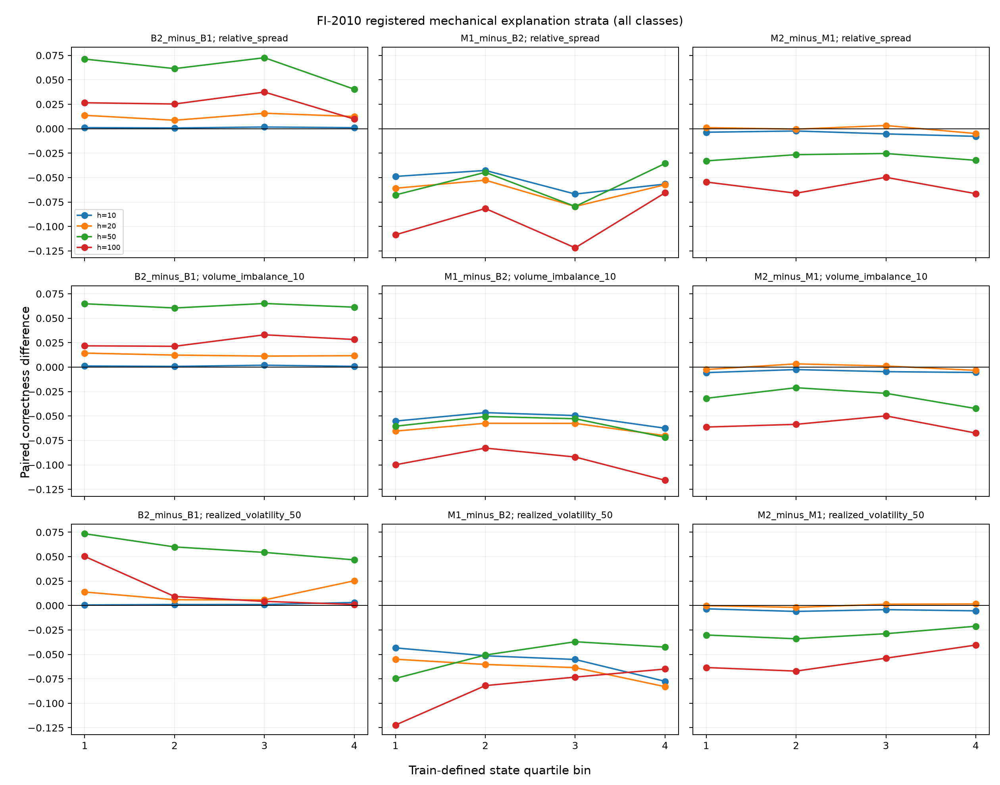

# Leakage-Audited Deep Learning on Limit Order Books

[](https://github.com/kartikmunjal/Lob-DL/actions/workflows/ci.yml)

Research implementation owned by Kartik Munjal. This repository studies predictive benchmarking and cross-market transfer on limit-order-book data. It makes no alpha or tradability claim and is separate from any live or fund research ledger.

The protocol is frozen in [`docs/PREREGISTRATION.md`](docs/PREREGISTRATION.md), with dated additions in [`docs/AMENDMENTS.md`](docs/AMENDMENTS.md), and the machine-readable settings are in [`configs/protocol.yaml`](configs/protocol.yaml). Results are generated by scripts from primary data; no result table or figure is hand-edited.

The transfer audit performs order-book reconstruction from the first sample snapshot, validated against vendor book files. It does not claim reconstruction from an empty pre-open state.

## Status

The preregistered study and post-test analyses are complete. The generated result
summary is in [`reports/generated/RESULTS.md`](reports/generated/RESULTS.md), the
immutable registered-report inventory is in
[`reports/results/MANIFEST.json`](reports/results/MANIFEST.json), and the public
data-integrity audits are in [`reports/audits`](reports/audits).

The LOBSTER vendor books are the primary transfer input. Reconstructed books are
reported only as the preregistered exact-match sensitivity analysis. All result
tables and figures are regenerated by `scripts/generate_report_assets.py`; the
publication bundle is checked by `scripts/verify_study_complete.py`.

## Study 2: stress-testing the Study 1 conclusions (post-hoc, exploratory)

Study 1 is frozen. Study 2 re-analyzes its saved predictions with stricter inference and
return-unit metrics. Because Study 1 test results had already been seen, none of this is
confirmatory; protocol and caveats are in [`docs/STUDY2_PROTOCOL.md`](docs/STUDY2_PROTOCOL.md),
results in [`reports/study2/RESULTS.md`](reports/study2/RESULTS.md), and the plan for
confirmatory follow-ups in [`docs/ROADMAP.md`](docs/ROADMAP.md).

**1. The gradient-boosting advantage is robust to stock-day inference, with one exception.**
The registered window bootstrap treats ~10^5 overlapping windows as nearly independent, giving
intervals a median of 10.6x narrower (10th-90th percentile: 3.7x-21x) than resampling the 15 stock-day test clusters (figure below).
Using the cluster as the unit, 142 of the 164 registered FI-2010 comparisons remain
significant after Holm correction over the whole family. LightGBM beats DeepLOB at h10, h20 and h100
in 15 of 15 stock-days, but **not** at h50 (10 of 15 stock-days, Holm p = 0.26).

**2. LOBSTER claims cannot be confirmed at ticker level.** With five tickers the smallest attainable
sign-flip p-value is 0.0625, so no LOBSTER comparison can reach 0.05 by construction. LightGBM leads
DeepLOB on 5 of 5 tickers at every horizon with matched labels, which is consistent evidence but not a
significance claim.

**3. No model's strongest signals clear the cost of crossing the spread.** Mean forward move in the top
signal decile is at most 0.72 bps (FI-2010) and 0.24 bps (LOBSTER), against half-spreads of about
7.8 bps and 2.4 bps. All 40 system-horizon cells have negative taker edge. This is a descriptive
statement about cross-fitted deciles, not a trading simulation.

**4. FI-2010 labels are only loosely tied to the public book.** The shipped labels match the documented
formula on public prices in 64% (h10) to 25% (h100) of rows. Last-move persistence scores 0.80 macro-F1
on those labels yet has a *negative* rank correlation (IC -0.09) with realized public-price moves.
FI-2010 return-unit numbers therefore need care; the LOBSTER ones, where labels and returns share a source,
are cleaner (IC 0.21-0.24 for logistic and LightGBM at h50-h100, 0.09-0.12 for DeepLOB).





### Known limitations

- Ten days, five Nordic stocks, 2010: no regime, drift or data-scaling claims are supported.
- Five LOBSTER tickers: ticker-level inference has very little power.
- LightGBM receives engineered features while the deep models receive the raw book, so architecture and
  representation are confounded (first item on the roadmap).
- Selection was best-of-12 on validation; width and depth of the architectures were not searched.

<!-- BEGIN GENERATED KEY FINDINGS -->
## Key findings

All numbers are macro-F1 from the registered reports. Full tables, per-class metrics, and paired comparisons are in [`reports/generated/`](reports/generated/) and [`reports/generated/tables/`](reports/generated/tables/).

`Fixed` retains the FI-2010 threshold unchanged on LOBSTER; `matched` uses the preregistered per-ticker threshold selection that matches FI-2010 training-class proportions.

The 95% intervals measure test-window sampling uncertainty using moving blocks within stock-day and fitted seed, pooled across seeds; seed-to-seed standard deviation is reported separately.

**1. A tuned gradient-boosted baseline beats both deep models on FI-2010 at every horizon.**

| Horizon | Persistence | LightGBM | DeepLOB | Transformer |
|---|---:|---:|---:|---:|
| 10 | 0.798 | 0.805 | 0.709 | 0.705 |
| 20 | 0.689 | 0.716 | 0.620 | 0.623 |
| 50 | 0.473 | 0.829 | 0.765 | 0.738 |
| 100 | 0.366 | 0.885 | 0.789 | 0.731 |

At horizon 10, persistence alone is 0.798. LightGBM adds 0.007 over it in the registered paired comparison (95% CI [0.006, 0.007]), while DeepLOB is 0.709.

**2. Zero-shot transfer to LOBSTER with fixed labels collapses to near chance.**

No trained model exceeds the majority baseline at horizons 10 and 20 (best trained model: 0.323; majority: 0.333). Across all four horizons, trained-model point estimates range from 0.200 to 0.323.

**3. With matched labels, signal reappears but stays modest.**

LightGBM ranges from 0.417 to 0.498, against persistence from 0.415 to 0.453. At horizon 10 their point estimates are 0.417 and 0.415. At horizon 50, the registered paired LightGBM-minus-persistence difference is 0.040 (95% CI [0.038, 0.041]).

**4. Model complexity did not buy transfer in the tested comparisons.**

For FI-2010 primary and LOBSTER matched-label transfer, every registered paired macro-F1 comparison favored LightGBM over DeepLOB and the transformer at each tested horizon. This statement does not extend beyond these datasets, label variants, models, or horizons.

This repository makes no alpha or tradability claim. Results describe predictive benchmarking under the frozen protocol only.

### Figures





## Reproduce

Regenerate the public tables, figures, summary, and this findings block:

```bash
python scripts/generate_report_assets.py --artifacts artifacts --output reports/generated
```

Check the complete registered publication bundle:

```bash
python scripts/verify_study_complete.py --artifacts artifacts --reports reports
```
<!-- END GENERATED KEY FINDINGS -->
