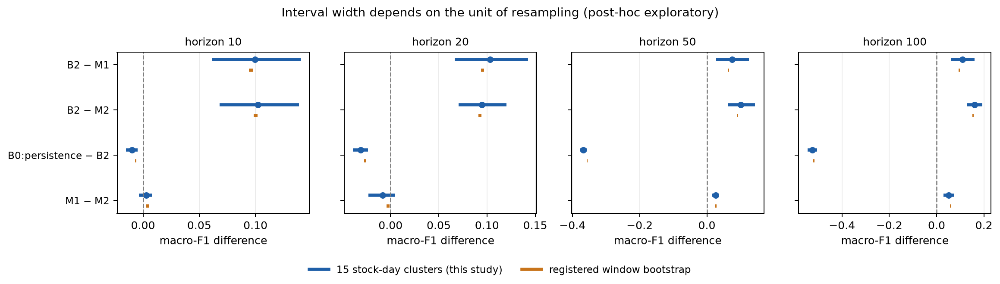
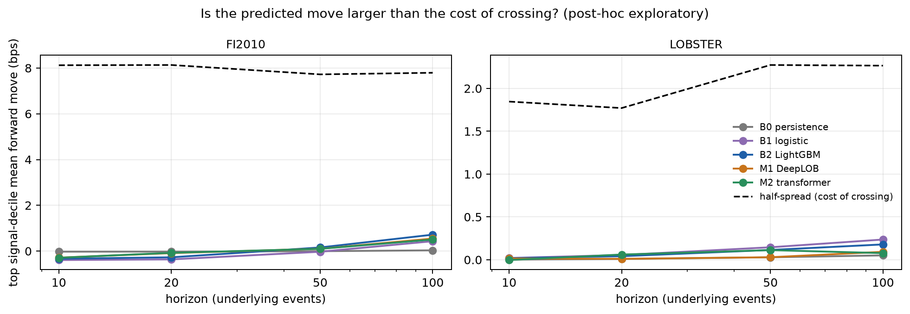

# Study 2 results (post-hoc exploratory)

Generated by `scripts/generate_study2_assets.py`. These re-analyze frozen Study 1
predictions and carry no confirmatory status.

## A1: do registered comparisons survive stock-day inference?

| Dataset | Labels | Comparisons | Clusters | Min. attainable p | Block CI excludes 0 | Also Holm-significant |
|---|---|---:|---:|---:|---:|---:|
| FI2010 | primary | 164 | 15 | 6.1e-05 | 161 | 142 |
| LOBSTER | fixed | 60 | 5 | 0.062 | 60 | 0 |
| LOBSTER | matched | 60 | 5 | 0.062 | 60 | 0 |

## A2: return-unit evaluation

**Read FI-2010 rows with care.** The shipped FI-2010 labels agree with the
public decimal-precision price formula on only 64% (h10), 54% (h20), 37% (h50)
and 25% (h100) of rows (`reports/generated/tables/fi_label_formula_agreement.csv`).
At h10, 62% of rows labeled *up* have exactly zero realized public-price move, and
last-move persistence scores 0.80 macro-F1 on labels while its signal has IC −0.09
against realized public-price moves. The labels are therefore only weakly tied to
moves observable in the public book, so FI-2010 IC, R² and mark-outs measure
agreement with *public-price* moves, not with the labels the models were trained on.
LOBSTER labels and returns both come from the same vendor book and are internally
consistent, so LOBSTER rows are the cleaner return-unit evidence. LOBSTER has five
clusters (tickers); its cluster intervals are indicative only.

| Dataset | System | Horizon | Mean cluster IC | OOS R² | Top-decile move (bps) | Half-spread (bps) | Taker edge (bps) |
|---|---|---:|---:|---:|---:|---:|---:|
| FI2010 | B2 LightGBM | 10 | -0.010 | 0.0067 | -0.33 | 8.12 | -8.46 |
| FI2010 | M1 DeepLOB | 10 | -0.013 | 0.0048 | -0.29 | 7.93 | -8.21 |
| LOBSTER | B2 LightGBM | 10 | 0.141 | 0.0009 | 0.02 | 1.85 | -1.83 |
| LOBSTER | M1 DeepLOB | 10 | 0.058 | 0.0000 | 0.01 | 2.31 | -2.30 |
| FI2010 | B2 LightGBM | 20 | 0.039 | 0.0014 | -0.27 | 8.13 | -8.41 |
| FI2010 | M1 DeepLOB | 20 | 0.054 | 0.0004 | -0.09 | 7.90 | -7.99 |
| LOBSTER | B2 LightGBM | 20 | 0.184 | 0.0054 | 0.04 | 1.77 | -1.73 |
| LOBSTER | M1 DeepLOB | 20 | 0.070 | -0.0018 | 0.01 | 2.06 | -2.05 |
| FI2010 | B2 LightGBM | 50 | 0.087 | 0.0015 | 0.16 | 7.72 | -7.57 |
| FI2010 | M1 DeepLOB | 50 | 0.074 | 0.0014 | 0.10 | 7.56 | -7.46 |
| LOBSTER | B2 LightGBM | 50 | 0.214 | 0.0156 | 0.11 | 2.27 | -2.16 |
| LOBSTER | M1 DeepLOB | 50 | 0.121 | 0.0003 | 0.03 | 1.80 | -1.77 |
| FI2010 | B2 LightGBM | 100 | 0.124 | 0.0102 | 0.72 | 7.79 | -7.08 |
| FI2010 | M1 DeepLOB | 100 | 0.106 | 0.0081 | 0.55 | 7.48 | -6.93 |
| LOBSTER | B2 LightGBM | 100 | 0.241 | 0.0285 | 0.18 | 2.27 | -2.09 |
| LOBSTER | M1 DeepLOB | 100 | 0.092 | 0.0039 | 0.09 | 2.19 | -2.10 |

